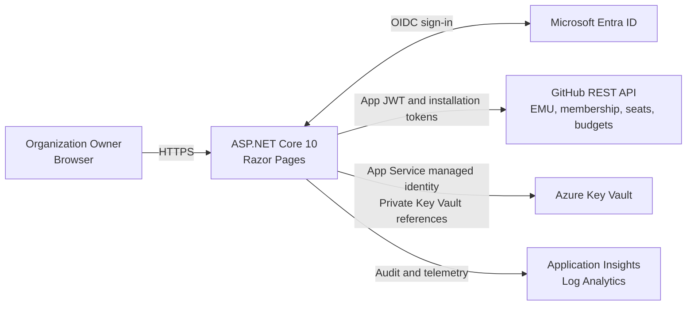

# Copilot Budget Administration

**Give Organization Owners a focused workspace for GitHub Copilot AI-credit budgets, without granting them enterprise-wide billing roles.**


A server-rendered portal for **delegated budget administration** in GitHub
Enterprise Cloud environments using **Enterprise Managed Users (EMU)**.
Sign in with Microsoft Entra ID, see your administered organizations and
eligible destinations, and manage their supported budgets directly on GitHub.

**GitHub remains the source of truth and the budget-enforcement engine.**
The portal adds an application-specific delegation and usability layer, not
another billing system.

[Install step by step](docs/deployment-step-by-step.md) |
[Architecture](docs/architecture.md) |
[Deployment reference](docs/deployment.md) |
[Local development](docs/development.md)

> [!WARNING]
> **Independent proof of concept, not an official GitHub or Microsoft product.**
> This project is not affiliated with, sponsored, endorsed, maintained or
> supported by GitHub or Microsoft. It is not certified or represented as
> production-ready. The adopting organization must review, test and explicitly
> approve it before deployment or use. It can make real changes to GitHub
> budgets.
> Read the [full disclaimer](#disclaimer-and-adoption-responsibility).

## Why use it alongside GitHub's UI?

GitHub's native billing UI already creates and manages budgets. This project
does **not** claim to unlock budget types that GitHub does not support.
Its value is a purpose-built experience and policy layer for organizations
that want to delegate a defined subset of financial administration.

| Your need | What this portal adds |
| --- | --- |
| Corporate sign-in | Single-tenant Entra SSO and automatic EMU identity resolution through SCIM, without an application-maintained user mapping. |
| A workspace for each Owner | One filtered view across organizations the signed-in person currently administers, with eligible users and cost centers. |
| Your own delegation rules | Server-side checks combining live ownership, membership, Copilot seats, cost-center composition and a configured per-budget amount ceiling. |
| No broad billing role for the person | A backend-only GitHub App performs authorized changes; the person does not need an Enterprise Billing Manager role. |
| Deliberate, traceable changes | Required confirmation and reason, structured backend audit events, explicit errors and optimistic conflict detection. |
| A focused interface | Budget search, scope filters, English/Italian localization and a schematic reference of the GitHub APIs actually invoked. |
| Less runtime privilege | Read-only discovery of administrator-installed enterprise and organization Apps; no installation-ID list to maintain. |

For example, an Owner of two organizations can manage eligible budgets from
one workspace while another organization's budgets remain outside their
portal access. A licensed user shared between organizations can still be an
eligible destination, but **an individual budget affects that person's total
consumption**, not just consumption in one organization.

## What can you manage?

Only **`BundlePricing` / `ai_credits`** budgets are managed.

| Scope | View / create / update / delete | Important distinction |
| --- | --- | --- |
| Cost-center per-user default | Yes, for eligible nonempty user-only centers | Caps each user's included and additional consumption; every assigned user must be an authorized licensed member. |
| Individual user override | Yes, for licensed members of owned organizations | Caps that user's included and additional consumption across organizations; optional expiry. |
| Enterprise-wide or repository budgets | No | Outside the delegation model. |

- Amounts are **whole monthly USD**, not a number of credits.
  The portal uses the conversion **1 USD = 100 AI credits** for presentation.
- Both supported scopes require usage stopping; it cannot be disabled.
- `MaxBudgetAmount` limits each created or updated budget.
  **It is not an aggregate departmental spending cap.**
- Shared organization membership alone does not exclude an authorized user.
  Cost centers retain stricter attribution and direct-assignment checks.
- Enterprise teams, repositories, empty centers, ambiguous names and
  unauthorized resources are excluded from cost-center delegation.
  Centers containing organizations are not budget destinations.
  GitHub supports team-based per-user centers, but this PoC does not verify
  enterprise team membership.

The portal does not assign licenses, change membership, create cost centers,
redistribute included credits or provide a multi-stage approval workflow.

## Architecture at a glance



1. Entra authenticates the person using authorization-code flow with PKCE.
2. The backend resolves the Entra `oid` to an active EMU through SCIM
   `externalId`, then verifies the canonical GitHub account.
3. The administrator installs one enterprise-owned GitHub App at enterprise
   level and in the organizations to include in the portal. The portal
   discovers and verifies those installations without changing them or
   requesting repository permissions. Uninstalled organizations are excluded;
   their logins remain in the complete inventory used for center isolation.
4. Organization-scoped tokens verify active ownership, membership and Copilot
   seats. An enterprise-scoped token reads cost centers and budgets.
5. The service filters access and rechecks authorization before every budget
   mutation. Supported changes are written directly to GitHub.

### Technical foundations

| Area | Implementation |
| --- | --- |
| Application | C#, .NET 10, ASP.NET Core Razor Pages; views compiled at build/publish time. |
| Identity | Single-tenant Microsoft Entra ID OIDC, secure cookie session, SCIM-based EMU resolution. |
| GitHub authentication | Server-side RS256 App JWTs and short-lived installation tokens. No browser-held GitHub credential. |
| Budget data | Live GitHub REST reads and writes; no separate budget database. |
| Runtime loading | Operation-specific reads, owned-organization member inventories, at most four concurrent GitHub requests per process, and rate-limit cooldowns; authorization is still rechecked live. |
| UI | HTML, CSS and small vanilla JavaScript enhancements; no external UI framework or CDN dependency in the portal. |
| Localization | Standard ASP.NET Core localization and shared `.resx` resources; English by default, Italian selectable. |
| Hosting | Linux Azure App Service, initially one B1 instance, provisioned with Bicep and `azd`. |
| Secrets and network | Key Vault references, managed identity, VNet integration, private endpoint/DNS for Key Vault. |
| Diagnostics | Structured audit events, Application Insights and Log Analytics. |

Read the [architecture and trust-boundary documentation](docs/architecture.md)
for authorization rules, caching, REST integration and operational limits.

## Install and try it

Start with the **[step-by-step installation guide](docs/deployment-step-by-step.md)**.
It covers the required Entra registration, GitHub App permissions and approval,
private key, local configuration, Azure deployment, callbacks and acceptance
checks.

After completing those prerequisites:

```powershell
azd env new budget-portal-poc
azd env set PORTAL_DEPLOYMENT_CONFIG scripts/deployment.local.json
azd up
```

The deployment creates Azure resources and uses supplied administrator-managed
credentials. It does **not** create Entra registrations or register callbacks
for you. The administrator must add the callback URLs before sign-in.

For code-only updates, use `azd deploy`. For configuration or secret changes,
follow the [deployment reference](docs/deployment.md).

### Preview without enterprise credentials

The test project includes a loopback-only UI preview with synthetic identity
and budgets:

```powershell
dotnet dev-certs https --trust
dotnet run --project .\tests\BudgetPortal.Web.Tests -- --preview
```

Open `https://localhost:7443`. Budget writes are simulated and do not persist.
This is **test-only tooling**, not a production authentication bypass.
See [local development](docs/development.md) for real local configuration,
build and test commands.

## Documentation

| Guide | Audience |
| --- | --- |
| [Step-by-step installation](docs/deployment-step-by-step.md) | Administrators setting up their first evaluation environment. |
| [Architecture and technical details](docs/architecture.md) | Engineers reviewing the integration, authorization and trust boundaries. |
| [Deployment and operations reference](docs/deployment.md) | Operators managing infrastructure, credentials, updates and troubleshooting. |
| [Development and testing](docs/development.md) | Contributors building, running and testing locally. |
| In-portal **API reference** at `/ApiReference` | Signed-in users inspecting the 15 runtime GitHub endpoints, invocation conditions, permissions and payloads. The page makes no GitHub calls. |

## Disclaimer and adoption responsibility

This is an **independent, experimental proof of concept**. It is not affiliated
with, sponsored, endorsed, maintained or supported by **GitHub or Microsoft**.
Product names and trademarks belong to their respective owners and are used
only to describe the integration.

The project is provided **as is**, without warranties or guarantees of
security, availability, correctness, compatibility, regulatory compliance or
spending-limit enforcement, to the extent permitted by applicable law.
Documentation and test results are not a certification or production
approval, and are not legal, financial or security advice.

**Before deploying or using it, the adopting organization is responsible for:**

- Reviewing the code, dependencies, architecture and broad GitHub App
  permissions, and obtaining its own security, legal, privacy and operational
  approvals.
- Testing authorization, failure behavior and budget effects in an approved
  nonproduction environment.
- Protecting credentials, deployment state, data-protection keys and logs;
  defining access, retention, rotation, monitoring and incident response.
- Validating current GitHub API availability, billing behavior, vendor terms
  and the effect of global user budgets on other organizations.
- Accepting Azure costs and any consequences of budget creation, modification
  or deletion.

Use is at the adopter's own risk. The project does not promise to prevent
overspending, outages, unauthorized use or data loss, and maintainers do not
provide a vendor support commitment. Any limitation of liability is subject
to applicable law and applicable license terms. This disclaimer is **not a
software license** and does not grant rights beyond any applicable license.
