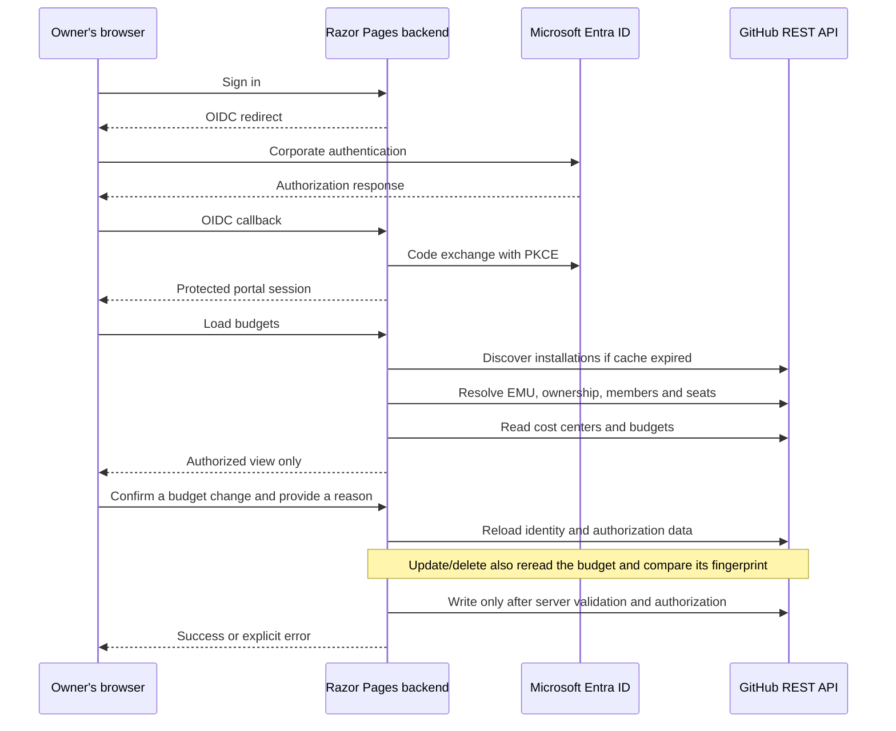

# Architecture and technical details

[Back to README](../README.md) | [Installation](deployment-step-by-step.md) |
[Operations](deployment.md) | [Development](development.md)

This document describes the current PoC implementation, not a security
certification or production architecture approval.
The [project disclaimer](../README.md#disclaimer-and-adoption-responsibility)
applies.

## Design intent

The portal provides a delegated workspace over GitHub's native budget APIs.
It has **no separate budget database** and does not implement a billing,
credit-allocation or spending-enforcement engine. GitHub owns persisted
budgets, consumption data, precedence and enforcement behavior.

The application supplies corporate authentication, a narrower authorization
policy, input validation, confirmation, audit events and a focused UI.
Users do not receive the GitHub App's credentials or an enterprise billing
role.

## Components and request flow

Discovery reads the existing App installations and complete enterprise
organization inventory. The administrator installs the App at enterprise
level and in the organizations to include in the portal. At least one
installed organization must belong to the configured enterprise. Uninstalled
organizations are excluded from owner/member/seat checks. The complete
enterprise login inventory is retained separately for center isolation;
missing installations elsewhere do not block an installed organization.
Suspended in-scope installations, ambiguous IDs/logins and incomplete
inventories still fail closed. Installations outside the configured enterprise
are not used. Discovery never changes an installation.

| Component | Responsibility |
| --- | --- |
| [Program](../src/BudgetPortal/Program.cs) | Configuration, OIDC/cookies, authorization policy, localization, data protection, headers and middleware. |
| [Razor Pages](../src/BudgetPortal/Pages) | HTML views, validated form inputs, confirmation/reason capture and calls to the budget service. |
| [GitHubBudgetService](../src/BudgetPortal/Services/GitHubBudgetService.cs) | Identity resolution, resource inventories, delegated authorization, budget parsing, CRUD and audit events. |
| [GitHubInstallationDiscovery](../src/BudgetPortal/Services/GitHubInstallationDiscovery.cs) | Read-only discovery and validation of administrator-installed enterprise and organization Apps. |
| [GitHubApi](../src/BudgetPortal/Services/GitHubApi.cs) | App JWTs, installation tokens, API-origin validation, HTTP requests and safe error translation. |
| [API reference](../src/BudgetPortal/Pages/ApiReference.cshtml.cs) | Static catalog of the 15 runtime GitHub endpoints and their page/action-specific invocation conditions, verified against transport call sites by tests. |
| [Bicep infrastructure](../infra) and [deployment script](../scripts/deploy.py) | Azure resources, protected configuration preparation, callback guidance and startup checks. |

## Identity and authorization

### Person identity

The portal uses single-tenant Entra OIDC authorization-code flow with PKCE.
The authenticated `tid` and `oid` claims come from the session, not submitted
form fields. The backend queries enterprise SCIM for
`externalId eq "oid"` and requires exactly one matching active EMU.

A validated SCIM `profileUrl` identifies the canonical GitHub login on the
configured host. When absent, `userName` is a fallback, confirmed by a user
lookup. Email addresses and display names are not identity mappings.

### Owner and destination eligibility

- Ownership requires the current GitHub membership to have `role=admin` and
  `state=active` in at least one installed organization of the configured
  enterprise. Ownership in an uninstalled organization does not grant access.
- Individual destinations are the union of **current members with Copilot
  seats** in owned organizations. Additional membership elsewhere does not
  remove this eligibility.
- Individual budgets affect total user consumption across organizations.
  Multiple eligible Owners may administer the same global user budget.
- Cost centers require unambiguous attribution. Assigned organizations must
  be owned; directly assigned users must be eligible licensed members.
  Direct foreign/ambiguous assignments remain subject to isolation checks.
- Empty centers, unsupported/unknown resource types, teams, repositories and
  unauthorized resources are excluded.
- A cost-center default requires a nonempty center consisting only of
  authorized direct users. Organization-containing centers are never
  budget destinations, but remain part of complete attribution/isolation checks.

### Before a budget write

The server does not trust dropdowns, hidden inputs, IDs or extra POST fields.

| Operation | Checks before the GitHub write |
| --- | --- |
| Create | Validate input; reload access; authorize scope/target; enforce amount ceiling and uniqueness; construct the payload server-side. |
| Update | Reload access; authorize the listed and freshly read budget; compare fingerprint; keep scope/target unchanged; validate amount and uniqueness; preserve alerts. |
| Delete | Validate reason; reload access; read the stored scope; authorize the freshly reread budget; compare fingerprint. No enterprise budget listing is needed. |

Confirmation and reason are required by the page handlers.
Antiforgery protects POSTs against CSRF; it is **not** a replacement for
authorization against a signed-in user submitting a forged request.

## Credentials and trust boundaries

The enterprise-owned App requires:

- Enterprise billing: read/write.
- Enterprise organization installations: read.
- Enterprise SCIM: read.
- Organization Members: read.
- Organization GitHub Copilot Business / Copilot seat management: read.

An enterprise token has broader power than a portal user. **GitHub authorizes
the App; the service authorizes the person and destination.** A compromised
backend/key could bypass that application boundary, so key protection and
deployment access are critical.

The RSA private key, App JWTs and installation tokens remain server-side.
JWTs use RS256, the App ID as issuer, a backdated issue time and a nine-minute
expiry. Installation tokens are cached in private backend memory and used
only in outgoing GitHub requests.

App ID and client ID are identifiers, not authentication secrets.
No GitHub user OAuth token, personal access token or GitHub App client secret
is required. The Entra client secret is a separate server credential.
OIDC tokens are not saved into the portal authentication ticket.

The browser receives budget/destination data and a protected session cookie,
not the GitHub credential. The application uses Secure/HttpOnly session
cookies, antiforgery, HTTPS, no-store responses, Razor encoding and restrictive
security headers. These mechanisms are not a guarantee against every attack.

In Azure, App Service resolves Key Vault references using managed identity and
a private endpoint; the application reads the resolved configuration.
Data-protection keys persist under `/home/data/BudgetPortal/keys` to survive
restarts. Review key encryption, shared storage and operational access before
scaling out or using deployment slots.

## REST integration details

The API origin is restricted to `https://api.github.com/` or
`https://api.<subdomain>.ghe.com/`, not arbitrary Enterprise Server endpoints.
Route/query values are URI-encoded, redirects are disabled for the GitHub
HTTP client, and its timeout is 45 seconds. Requests send the configured
`X-GitHub-Api-Version`; the default is `2026-03-10`.

The signed-in `/ApiReference` page presents **15 method/path pairs**:
11 GET reads, one installation-token POST and three budget-write operations.
It includes an invocation map, grouped expandable endpoint details, minimum
App permissions, requests/responses, budget payloads and official links.
Installation discovery is read-only; the token POST issues a credential,
not an installation or budget.

The page is static documentation, not a live request log or permission audit.
Opening it never calls GitHub or the budget service and does not expose
configured enterprise identifiers or credentials. Backend GitHub REST calls
are covered; Entra OpenID Connect and Azure deployment are distinct boundaries.
Tests derive the current method/path inventory from GitHub transport call
sites and compare it with the catalog, so adding/removing a runtime endpoint
requires updating its documentation. Invocation rules are also protected by
the budget-service operation-specific loading tests.

Integration-specific behavior:

- Only `BundlePricing` / `ai_credits` cost-center per-user defaults and
  individual overrides are managed. Both cap each user's included and
  additional consumption and require usage stopping.
- If GitHub returns a supported budget with stopping disabled, the dashboard
  preserves that actual status and the edit form warns that saving will enable
  the required stop. Reading a budget never changes it.
- Cost-center default writes put the immutable **center ID** in
  `budget_entity_name`, even when reads return names.
- User writes use an empty `budget_entity_name` and a separate `user` login
  field. GitHub documents this field despite its omission from the generated
  body schema.
- `Org` and `User` cost-center resource types are normalized.
- Updates preserve existing alert settings. Only individual user overrides
  can expire; removing an expiry sends `null`.
- Known-incomplete pagination, duplicate records and inconsistent counts are
  rejected rather than used for financial authorization.
- GitHub 409/412 responses become conflicts; other upstream failures become
  explicit errors without exposing GitHub response bodies or credentials.
- Budget writes are not automatically retried.

## Caching, audit and limitations

Successful installation discovery is cached for **ten minutes per process**.
Installation tokens are cached until the earlier of GitHub expiry and one
hour, with a one-minute refresh margin.
Identity and ownership are reloaded for every budget-data request and mutation.
Membership, seats, centers and budgets are loaded according to the operation
and stored scope; no authorization inventory is cached.

### Operation-specific reads

| Request | Live data loaded |
| --- | --- |
| Dashboard | EMU and owner checks, owned-organization members and seats, all active cost-center compositions, and the paginated budget list. |
| New-budget form | The same authorized destinations, without reading budgets. |
| Edit/delete confirmation | EMU and owner checks; a single budget read identifies its stored scope, scope-relevant inventories are loaded, and the budget is reread and authorized before display. No budget listing or unused destination dropdowns. |
| Individual mutation | EMU and owner checks, complete members and seat inventories of owned organizations. Cost-center assignments do not revoke individual authorization and are not fetched. |
| Cost-center mutation | EMU and owner checks, owned-organization members and seats, and complete active-center compositions. Foreign/ambiguous assignments and unsupported resources still fail closed. |

Creation and update still enumerate all budget pages for uniqueness; updates
also authorize both the listed budget and the freshly reread record and
preserve immutable scope/target and alert settings. Delete uses a direct
fresh read and fingerprint comparison instead of enumerating unrelated
budgets. For existing records, the initial stored scope only selects required
dependencies; it does not authorize access. The reread must independently
resolve to an authorized target. A scope/target change during loading cannot
use omitted inventories to gain access.

Member inventories are fetched only for owned organizations. Foreign member
contents were not used by the eligibility rules: licensed members remain
eligible even with additional foreign memberships. Center isolation still
uses the **complete discovered organization login inventory** to reject
unknown organization attribution, plus every active center's composition.
No foreign member contents, credentials or unauthorized budget data are sent
to the browser.

An uninstalled organization is known but unauthorized, not an unknown
resource. Centers assigned to it are excluded. Direct user assignments to
such centers still participate in isolation checks, while the existing
enterprise-global individual-override eligibility remains unchanged.

These are fewer necessary live reads, not stale snapshots or client-side
authorization. A relevant upstream failure prevents the operation.

### Bounded parallel loading

Independent organization access checks run in batches of up to four.
After ownership is verified, member inventories, owned-organization Copilot
seat inventories and cost-center reads overlap. Cost-center details are also
read in bounded batches. Each resource's pagination remains sequential, and
each required inventory must succeed before authorization or a budget write.
Results are assembled after the reads complete, without concurrent mutation
of authorization dictionaries.

The singleton GitHub transport limits **all** outgoing requests, including
App/token requests and writes, to four in flight per process. It holds the
slot through response-body parsing and honors cancellation while waiting.
This limit is shared across signed-in users, not multiplied per dashboard.
Budget writes are never automatically retried.

HTTP 429, or HTTP 403 with `Retry-After` or an exhausted
`X-RateLimit-Remaining`, produces a localized explicit 502 rate-limit error.
The backend remembers a cooldown for the affected installation (or App
authentication scope), using `Retry-After`, the primary rate-limit reset
when exhausted, or one minute when no future reset is available. Queued and
new requests for that scope fail without further GitHub calls during the
cooldown. Other installation scopes remain usable. Cooldowns are local to
the process, not distributed or automatic retries.

Bounded parallelism reduces cumulative waiting, while operation-specific
loading reduces the number of calls for individual-budget pages and writes.
The full dashboard still enumerates all owned members/seats and active-center
resources. Initial discovery, large new-budget destination dropdowns, GitHub latency and API quotas can
still dominate very large enterprises. The 45-second HTTP timeout is not
a deadline for the entire dashboard. Additional instances would multiply
the transport limit and have separate caches/cooldowns.

Audit events record the operation, actor, reason, attempt and confirmed
success. They are backend logs, not a tamper-proof ledger or an approval
workflow. Operators control access, retention and monitoring.

Important limits:

- Access checks and writes are separate GitHub calls. A revocation/change
  after the last read can race with a write.
- The fingerprint detects earlier configuration changes, excludes ordinary
  consumption changes and is **not** an atomic GitHub `If-Match` transaction.
  Duplicate checks also precede the create request.
- A timeout/interruption can leave the result uncertain. Reload before
  retrying; do not assume a failed response proves no change occurred.
- GitHub consumption/attribution may update with delay. This PoC does not
  guarantee zero overspend or aggregate departmental limits.
- The initial Azure deployment is one B1 instance. It includes no WAF,
  private-only SCM or complete production security baseline.
- GitHub Data Residency does not establish the residency of Azure logs,
  audit or hosting. Review these separately.
- Local tests use simulated GitHub responses and do not certify a customer's
  live permissions, policies, API availability or end-to-end security.

For deployment and diagnostic procedures, use the
[operations reference](deployment.md). For tests and their limits, use
[development and testing](development.md).
